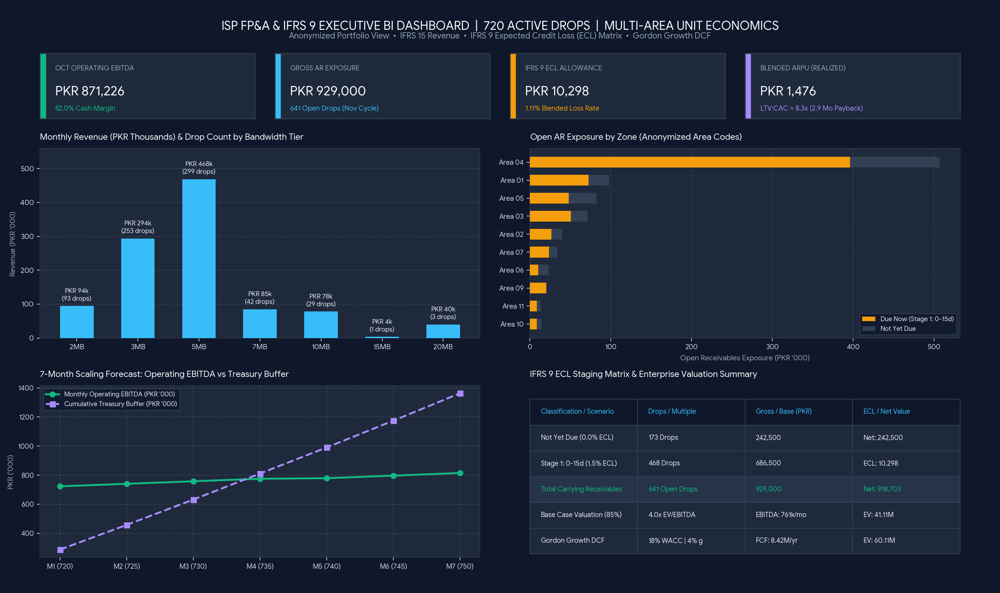

# Telecom / ISP FP&A & IFRS 9 Expected Credit Loss (ECL) Engine

End-to-end financial management, subscription billing reconciliation, unit economics, and IFRS 9 receivables impairment engine built for recurring broadband operations (700+ active subscriber drops).



## System Architecture
- **Double-Entry Trial Balance & Cash Book (`1000–5800`):** Automated ledger equilibrium checks and month-end expense variance controls.
- **IFRS 9 ECL Staging Matrix:** Classifies open receivables into `Not Yet Due (0%)`, `Stage 1: 0–15d (1.5%)`, `Stage 2: 16–30d (5.0%)`, and `Stage 3: 31+d (25.0%)` to calculate net carrying value.
- **Unit Economics & Zero-Based Budgeting (ZBB):** Tracks bandwidth cost per subscriber drop, ARPU, and dynamic subscriber-baseline expense benchmarks.
- **Valuation & Sensitivity Suite:** 3-case scenario modeling and Gordon Growth perpetuity DCF sensitivity.

## Tech Stack
`Power BI (DAX & Power Query)` | `Google Sheets & Excel` | `Python (pandas)` | `Xero & QuickBooks Online`

## Quick Start
```bash
pip install pandas
python ecl_aging_reconciler.py
```
