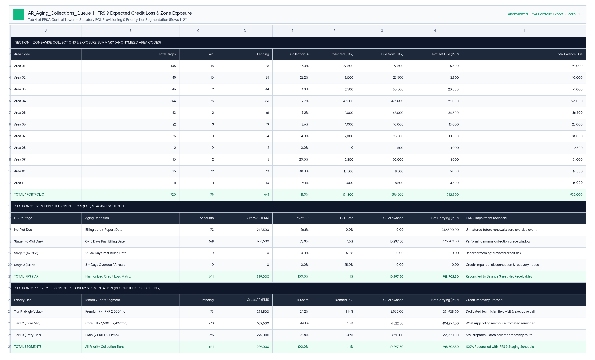
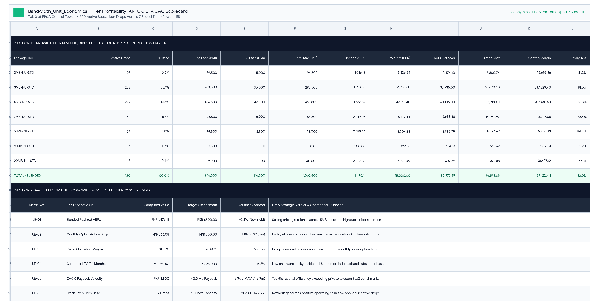
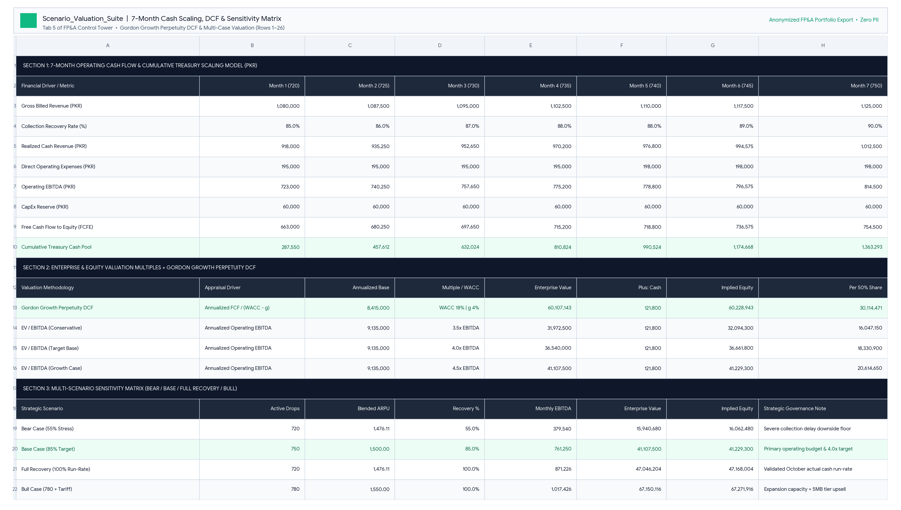

# Telecom / ISP FP&A & IFRS 9 Expected Credit Loss (ECL) Engine

End-to-end financial management, subscription billing reconciliation, unit economics, and IFRS 9 receivables impairment engine built for recurring broadband operations (720 active subscriber drops).

## Executive BI Control Tower


## Core Financial & IFRS Schedules

### 1. IFRS 9 Expected Credit Loss (ECL) & Zone Collections Matrix


### 2. Bandwidth Tier Unit Economics & LTV:CAC Scorecard


### 3. 7-Month Operating Cash Scaling & Gordon Growth DCF Valuation


## System Architecture
- **Double-Entry Trial Balance & Cash Book (`1000–5800`):** Automated ledger equilibrium checks and month-end expense variance controls.
- **IFRS 9 ECL Staging Matrix:** Classifies open receivables into `Not Yet Due (0%)`, `Stage 1: 0–15d (1.5%)`, `Stage 2: 16–30d (5.0%)`, and `Stage 3: 31+d (25.0%)` to calculate net carrying value (`PKR 918,702.50` net on `PKR 929,000.00` gross exposure).
- **Unit Economics & Zero-Based Budgeting (ZBB):** Tracks bandwidth cost per drop, realized ARPU (`PKR 1,476.11`), `8.3x LTV:CAC` (`2.9 mo` payback), and dynamic subscriber-baseline expense benchmarks.
- **Valuation & Sensitivity Suite:** 3-case scenario modeling and Gordon Growth perpetuity DCF sensitivity (`18% WACC`, `4% g`).

## Tech Stack
`Power BI (DAX & Power Query)` | `Google Sheets & Excel` | `Python (pandas)` | `Xero & QuickBooks Online`

## Quick Start
```bash
pip install pandas
python ecl_aging_reconciler.py
```
